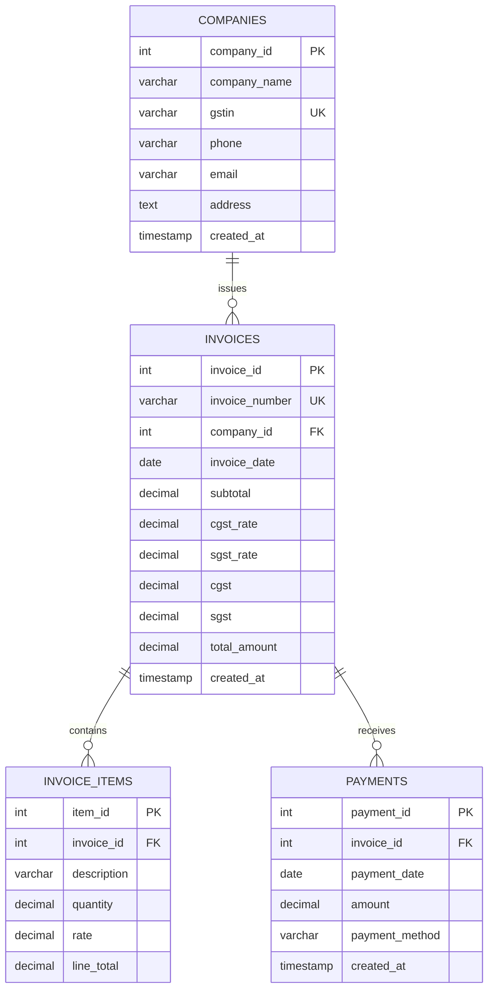

# Database design

The schema uses four related InnoDB tables with `utf8mb4`, primary keys,
foreign keys, and indexes. Import `database/database.sql` in phpMyAdmin; it
creates and selects the `billing_sales_db` database. The corresponding initial
table migration is in `database/migrations/001_create_initial_tables.sql`.

The application reads `DB_PORT` from `.env` and defaults to `3306` if it is
missing. XAMPP MySQL may use `3306` or `3307`; check the MySQL row's **Port(s)**
column in the XAMPP Control Panel and set `.env` accordingly.

## Relationships

- A company can have many invoices. Each invoice must refer to one company.
  Company deletion is restricted while invoices exist.
- An invoice has one or more invoice-item rows when invoice entry is added.
  Deleting an invoice cascades to its items.
- An invoice can have many payments. Payment rows prevent invoice deletion,
  preserving transaction history.

## Money and derived values

Money fields use MySQL `DECIMAL`, not floating-point columns. CGST and SGST
rates default to 2.50 percent each and can be overridden on an invoice. GST
amounts and invoice totals are recorded as decimal values. Paid total is the
sum of that invoice's payment amounts; pending balance is invoice total minus
paid total; status is `Unpaid`, `Partial`, or `Paid` based on those values.
These three values are intentionally not stored, so they cannot drift from
payment history.

The payments table rejects non-positive amounts with a CHECK constraint. The
application must additionally lock and check the invoice balance in the same
transaction before inserting a payment; a row-level CHECK cannot enforce an
aggregate across multiple payment records.
