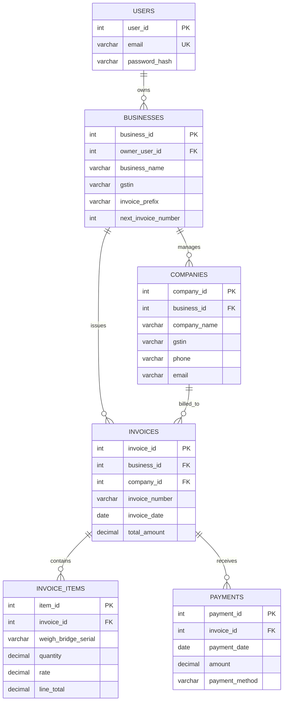

# Database design

The database uses MySQL/MariaDB, InnoDB, and `utf8mb4`. The four transactional
tables are `companies`, `invoices`, `invoice_items`, and `payments`. Authentication
and multi-business support add `users`, `businesses`, `installation_state`, and
`auth_login_attempts`. A legacy `seller_profile` table is retained only as the
one-time source for the first business profile.

Import `database/database.sql` for a new installation. An existing installation
that has already applied migrations 001 and 002 should apply
`database/migrations/003_auth_multi_business.sql` once. The migration temporarily
adds nullable `business_id` columns without deleting old business records. During
the first local account registration, a transaction creates the initial business
from `seller_profile` and assigns all unassigned companies and invoices to it.
Fresh imports use non-null tenant keys. Payment and invoice-item records remain
associated through their parent invoice. That first-user claim is explicit; rows
are not assigned to a guessed business.

The app reads `DB_PORT` from `.env`, defaulting to `3306`. XAMPP may use `3306`
or `3307`; check the MySQL row's **Port(s)** column in the XAMPP Control Panel.

## Relationships and isolation

- One user owns zero or more businesses. Each business has exactly one owner;
  shared membership is not implemented.
- One business has zero or more customer companies and invoices.
- A company can have many invoices. A composite `(business_id, company_id)`
  foreign key ensures an invoice cannot reference a company in another business.
- An invoice has invoice-item rows and payment rows. Items cascade on invoice
  deletion; payments restrict invoice deletion.
- Payments and invoice items do not duplicate `business_id`; their invoice
  relationship carries the business scope.
- `installation_state` stores the one-time legacy-claim flag.
- `auth_login_attempts` stores hashed email/IP keys and lockout metadata, never
  passwords.

## Money and derived values

Money fields use MySQL `DECIMAL`, not floating-point columns. CGST and SGST
default to the selected business's configured rate (2.50% each by default).
For inter-state invoices, the service applies the combined rate as IGST and
stores CGST/SGST as zero. For intra-state invoices, it applies CGST and SGST
and stores IGST as zero.

Paid amount is the sum of an invoice's payment amounts; pending balance is
invoice total minus paid amount; status is `Unpaid`, `Partial`, or `Paid`.
These values are intentionally derived rather than stored. Payment creation
locks the invoice and checks the aggregate balance in one transaction.

Invoice math uses integer paise. The browser preview is not trusted for writes.
Optional demo scripts are imported manually after registration and business
setup; they target the first business in the local database.
