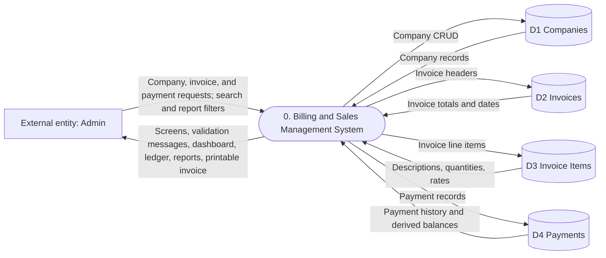

# Data Flow Diagram — Level 0

This context-level view shows the Administrator, the system boundary, and the
four database stores used by the implemented modules.

There is no authentication process in the current system; the Administrator
accesses the application directly. Database access is through PDO prepared
statements in the PHP models.

## PNG for Word / PDF

