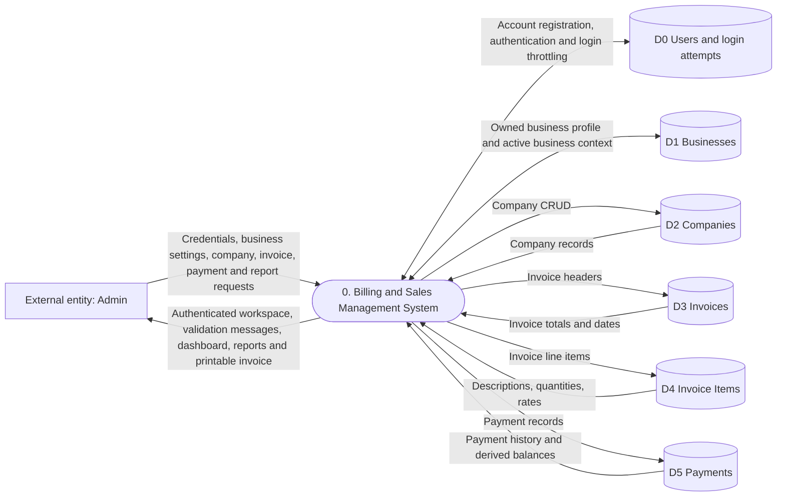
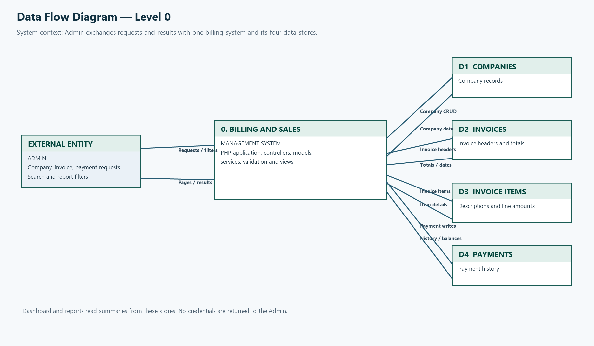

# Data Flow Diagram — Level 0

This context-level view shows the user, the system boundary, account/business
stores, and the four transactional data stores.

Each module query is restricted to the active business owned by the signed-in
user. Database access uses PDO prepared statements in the PHP models.

## PNG for Word / PDF

