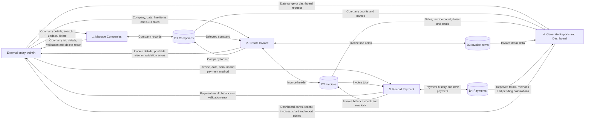

# Data Flow Diagram — Level 1

The Administrator interacts with four principal business processes. Dashboard
summary queries are included with **Generate Reports** because both display
read-only aggregates and summaries.

`Create Invoice` represents the invoice create, view, update, and delete
screens. `Manage Companies` represents full company CRUD, search, and the
company ledger. The payment process records and deletes payment rows; it does
not currently provide payment updates or a free-text payment search. Outstanding
balances and payment statuses are calculated from invoices and payments rather
than stored separately.

## PNG for Word / PDF

