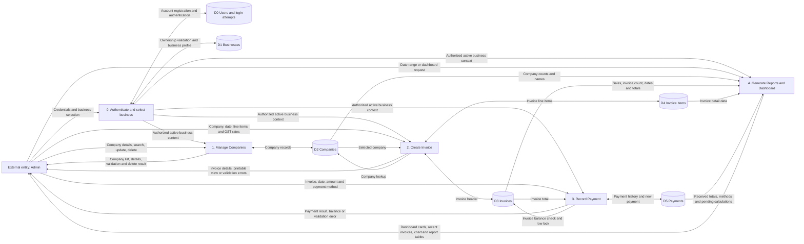
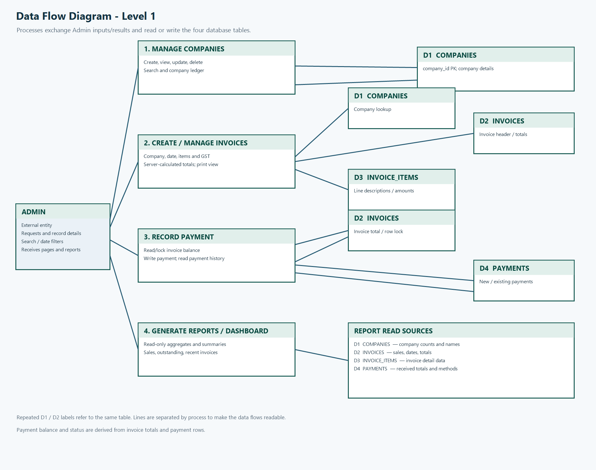

# Data Flow Diagram — Level 1

The signed-in user first selects an owned business. The four business processes
then operate only on that active business. Dashboard summary queries are
included with **Generate Reports** because both display read-only aggregates.

`Create Invoice` represents the invoice create, view, update, and delete
screens. `Manage Companies` represents full company CRUD, search, and the
company ledger. The payment process records and deletes payment rows; it does
not currently provide payment updates or a free-text payment search. Outstanding
balances and payment statuses are calculated from invoices and payments rather
than stored separately.

## PNG for Word / PDF

The included PNG is an older login-less snapshot; regenerate it from this Mermaid diagram.

