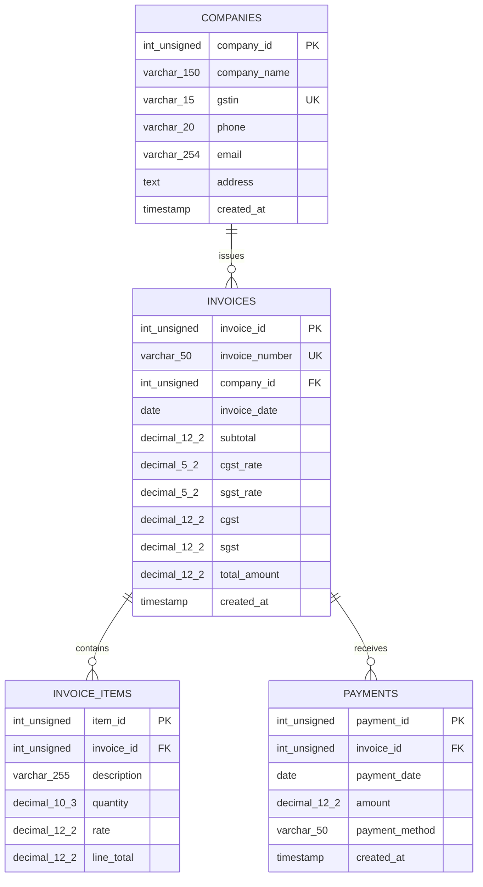

# Entity-Relationship Diagram

The database contains four InnoDB tables. A company can exist before it has
invoices, and an invoice can exist without payment rows. The invoice form
requires at least one item, although the database relationship itself permits
zero items.

`||--o{` means one parent row can be related to zero or many child rows, while
every child belongs to exactly one parent. Company deletion is restricted
while invoices exist. Deleting an invoice cascades to its items; an invoice
with payments cannot be deleted. Paid amount, pending balance, and payment
status are derived from payment rows and are not stored columns.

## PNG for Word / PDF

The Mermaid source above is retained for editing. This local PNG is included for
Word documents and PDF exports.

