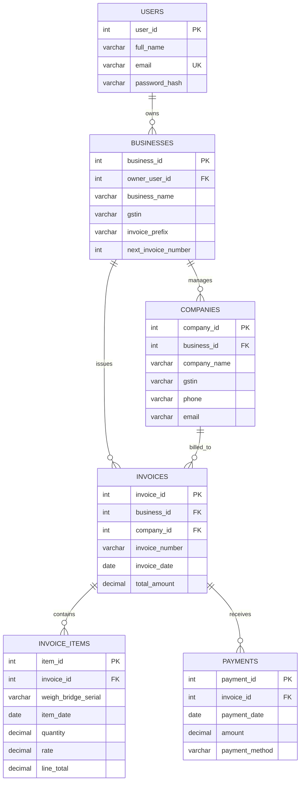
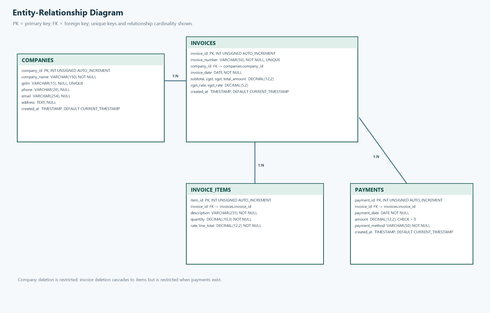

# Entity-Relationship Diagram

The diagram shows account ownership and business-level separation. Companies
and invoices store the active business ID; invoice items and payments are
scoped through their parent invoice. The legacy `seller_profile` is only used
once to initialize the first business.

`||--o{` means one parent can be related to zero or many child rows, while
every child belongs to exactly one parent. Company deletion is restricted
while invoices exist. Deleting an invoice cascades to its items; an invoice
with payments cannot be deleted. Paid amount, pending balance, and payment
status are derived from payment rows.

## PNG for Word / PDF

The Mermaid source above is current. The included PNG is an older four-table
snapshot; regenerate it from this Mermaid source before using it in a report.

