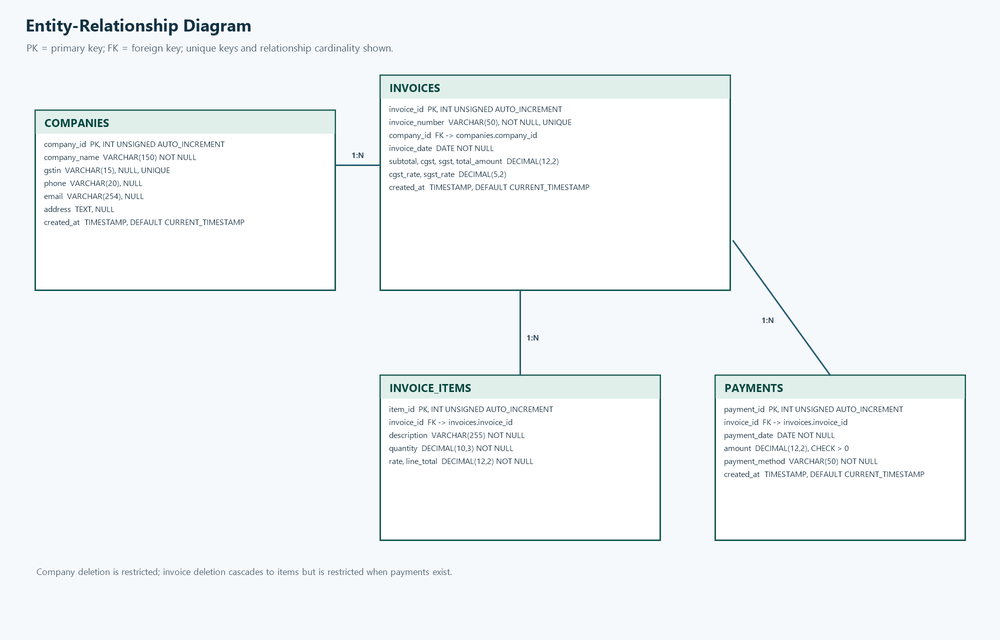
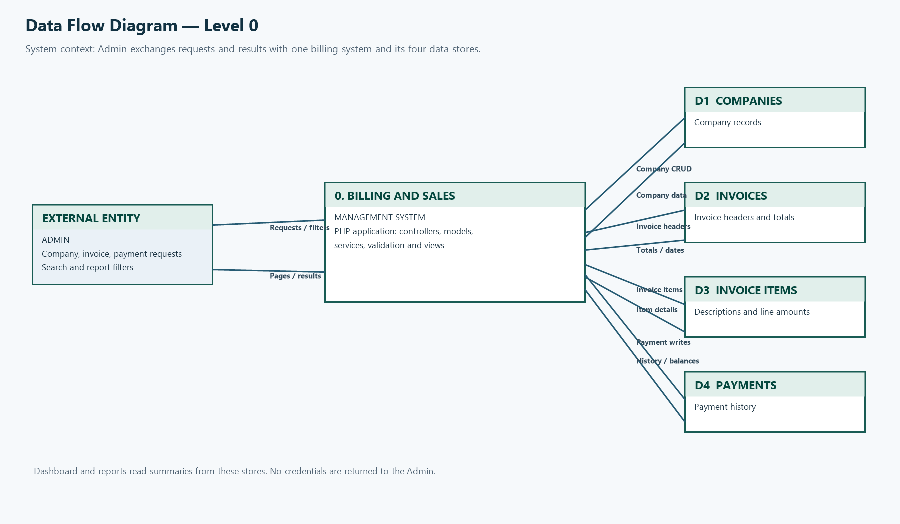
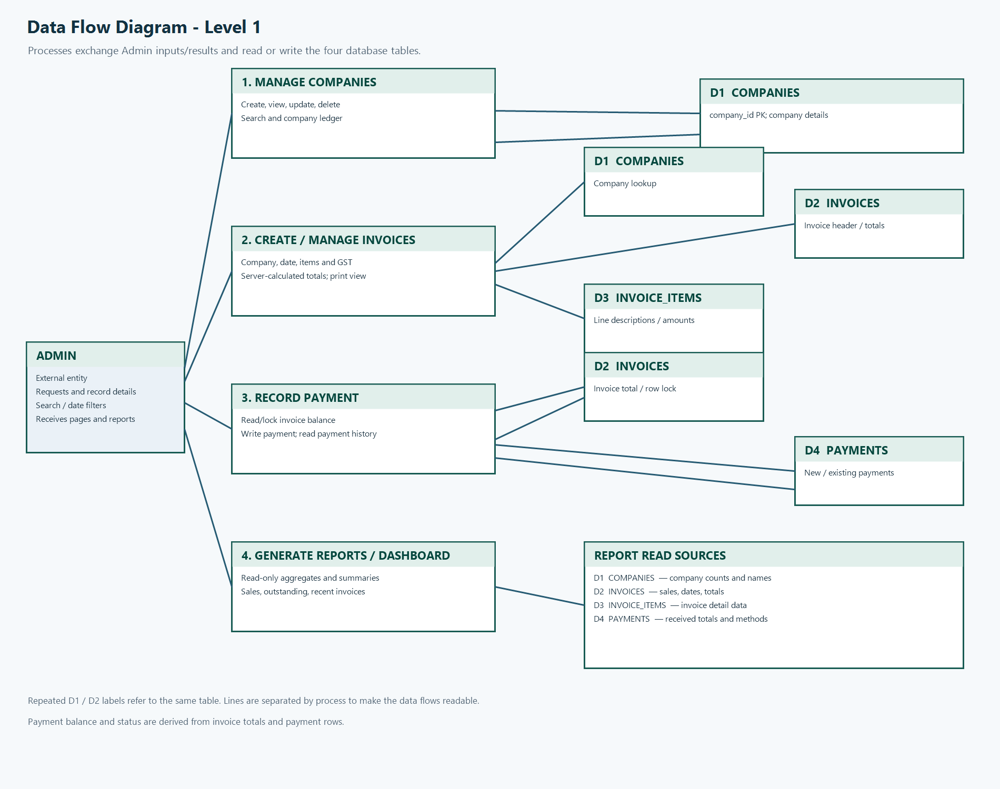
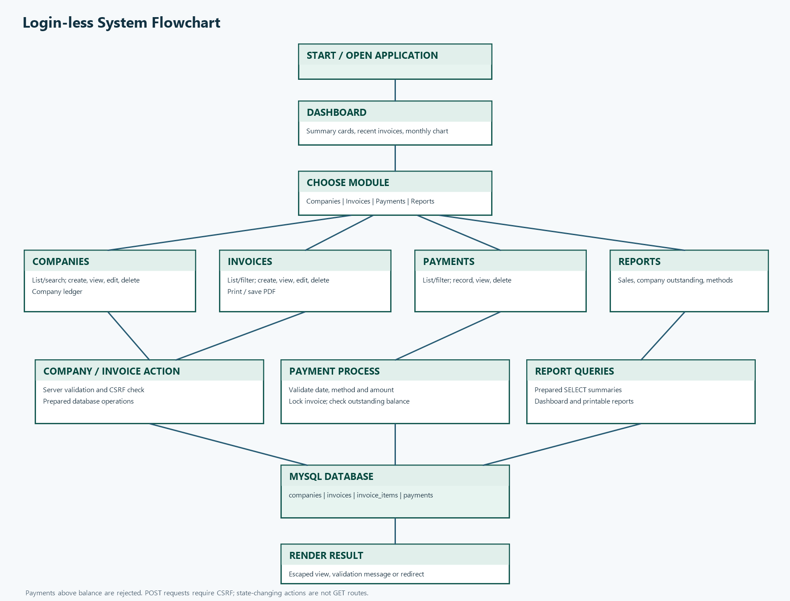
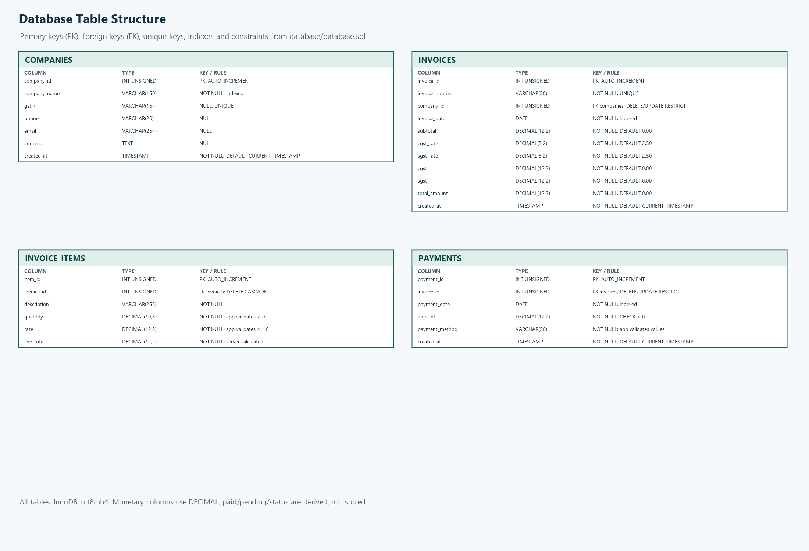

# Project Report Outline

## Cover Page

**Project:** Billing and Sales Management System

**Course/Semester:** BCA, 5th Semester

**Academic year:** [ACADEMIC YEAR]

**Submitted to:** [COLLEGE / DEPARTMENT / GUIDE NAME]

**Submitted by:** [GROUP NAME]

## Group Member Details

| No. | Student name | Roll number |
|---|---|---|
| 1 | [STUDENT 1 NAME] | [ROLL NUMBER] |
| 2 | [STUDENT 2 NAME] | [ROLL NUMBER] |
| 3 | [STUDENT 3 NAME] | [ROLL NUMBER] |
| 4 | [STUDENT 4 NAME] | [ROLL NUMBER] |

## Introduction

The Billing and Sales Management System is a small web application for keeping
company records, issuing GST invoices, recording partial or full payments, and
reviewing sales and outstanding balances. It is implemented with PHP 8+, MySQL,
HTML, CSS, and vanilla JavaScript for a local XAMPP environment.

## Problem Definition

Manual billing records make it difficult to keep invoice totals, payment
history, and pending balances consistent. This project adds secure user
accounts and separates each owner's businesses and billing records in a central
database.

## Objectives

- Maintain company records with create, view, update, delete, and search.
- Create GST invoices with one or more items and server-calculated totals.
- Record payments without allowing them to exceed the current invoice balance.
- Show invoice payment status and company-wise outstanding balances from
  payment history.
- Provide dashboard summaries, date-range reports, and print-friendly views.
- Authenticate users and restrict each request to an owned active business.

## Scope

The current application includes account registration/login, multiple
businesses per user, companies, invoices and invoice items, payments, a company
ledger, dashboard summaries, and reports. Invoice printing uses the browser's
print dialog and can be saved as PDF. Password-reset email delivery and shared
business memberships are not implemented. Payment update and free-text search
are also out of scope.

## Technology Used

- **Frontend:** HTML5, CSS3, vanilla JavaScript, and a local canvas chart script.
- **Backend:** PHP 8+ with a small custom autoloader and query-string router.
- **Database:** MySQL/MariaDB with InnoDB, `utf8mb4`, foreign keys, and PDO.
- **Local environment:** XAMPP on Windows, Apache, MySQL, and phpMyAdmin.
- No PHP framework, Composer package, JavaScript framework, or CDN is used.

## System Requirements

**Software:** Windows with XAMPP, PHP 8+, MySQL/MariaDB, a modern browser, and
an editor such as VS Code. Configure `.env` with the local database settings;
the DB port must match the XAMPP Control Panel.

**Database:** Import `database/database.sql` to create `billing_sales_db`,
account/business tables, and transactional tables. Existing installations use
additive migration 003 after migrations 001 and 002. Demo seeds are optional
and imported manually after registration.

**Hardware:** A computer capable of running XAMPP and a modern browser is
sufficient for a local academic demonstration. Exact minimum hardware
requirements depend on the installed XAMPP and operating system versions.

## System Analysis & Design

The application uses a lightweight MVC-style organization. `public/index.php`
checks authentication and the active owned business before routing requests.
Controllers coordinate input and views, models execute scoped prepared SQL,
and invoice/payment services enforce business rules and transactions. Views
escape dynamic output.

The main data tables are `users`, `businesses`, `companies`, `invoices`,
`invoice_items`, and `payments`, with installation/login-support tables. A user
owns businesses, each business has companies/invoices, and each invoice can
have multiple line items and payments. See [`er-diagram.md`](./er-diagram.md),
[`dfd-level-0.md`](./dfd-level-0.md), [`dfd-level-1.md`](./dfd-level-1.md),
and [`table-structure.md`](./table-structure.md).

Invoice values are calculated on the server using integer paise. Payment
recording locks the active-business invoice, checks its outstanding amount,
and inserts the payment in one transaction. Paid amount, pending balance, and
payment status are derived and not stored as separate columns.

### ER diagram

### Data Flow Diagram — Level 0

### Data Flow Diagram — Level 1

### System flowchart

### Database table structure

## Module Description

- **Dashboard:** total sales, received and pending amounts, company and invoice
  counts, five recent invoices, and monthly sales for six months.
- **Accounts and businesses:** register, sign in/out, edit business settings,
  add multiple businesses, and switch between owned businesses.
- **Companies:** full CRUD, validation, search, and the company ledger.
- **Invoices:** create, view, update, delete, list filters, GST calculation,
  line items, and print-to-PDF through the browser.
- **Payments:** record, view, delete, and filter by company, method, and date.
  Payment creation checks the balance under a database row lock.
- **Reports:** sales summary by invoice date range, company outstanding sorted
  by pending amount, and payment-method summary by payment date range.

## CRUD Operations

Companies and invoices provide create, read, update, and delete operations
within the active business. Businesses provide create, read, and update.
Company deletion is restricted when invoices exist. Invoice deletion is
restricted when payments exist and otherwise removes its line items. Payments
provide create, read, and delete; update and free-text payment search are not
implemented. Report pages are read-only. POST actions require CSRF tokens and
use redirect-after-post behavior.

## Screenshots

Insert screenshots captured from the running local application:

1. [DASHBOARD SCREENSHOT]
2. [COMPANY LIST / SEARCH SCREENSHOT]
3. [COMPANY DETAILS AND LEDGER SCREENSHOT]
4. [INVOICE FORM AND INVOICE PRINT SCREENSHOTS]
5. [PAYMENT FORM AND PAYMENT LIST SCREENSHOTS]
6. [REPORTS SCREENSHOT]

Do not include real customer or financial information in submitted screenshots.

## Testing

Execute and record manual results in [`test-cases.md`](./test-cases.md). The
table intentionally leaves Actual and Pass/Fail for the tester. Include
evidence for authentication, access control, business isolation, validation,
CSRF, invoice transaction behavior, overpayment rejection, delete restrictions,
date filters, and print layouts.

## Conclusion

The project connects user-owned business, company, invoice, item, and payment
records in a small PHP and MySQL application. It derives collection status from
payment history and provides scoped CRUD screens, dashboard, ledger, and report
views.

## Future Scope

- Configure email delivery for password recovery and add secure reset tokens.
- Add shared business memberships only if later required.
- Add payment update/search only if required by a later project specification.
- Extend reports or add export features if permitted by the project scope.
- Conduct additional testing with representative data and user feedback.

## References

- Project source code and schema in this repository.
- [README and local setup instructions](../README.md).
- [Architecture notes](./architecture.md).
- [Database design and relationships](./database-design.md).
- PHP manual: https://www.php.net/manual/
- MySQL reference manual: https://dev.mysql.com/doc/
- Mermaid syntax reference: https://mermaid.js.org/
