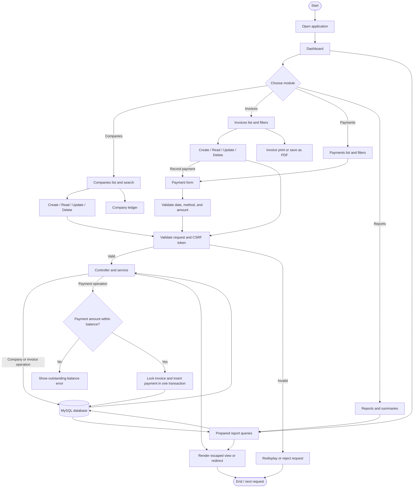
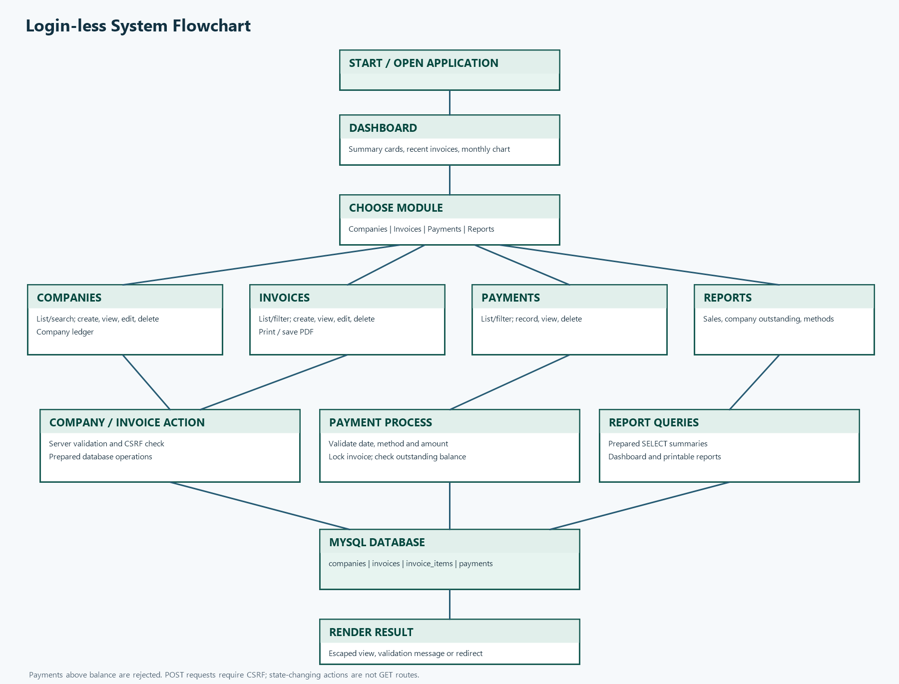

# System Flowchart

The current application has no login or user accounts. The Administrator opens
the dashboard directly. All pages use query-string routes such as
`index.php?r=invoices/index`; Apache rewrite rules are not required.

Every POST request is checked for a CSRF token. Create, update, and delete
actions use POST and redirect after processing. Invoice and payment amounts
are calculated or checked on the server; browser previews are not trusted.

## PNG for Word / PDF

