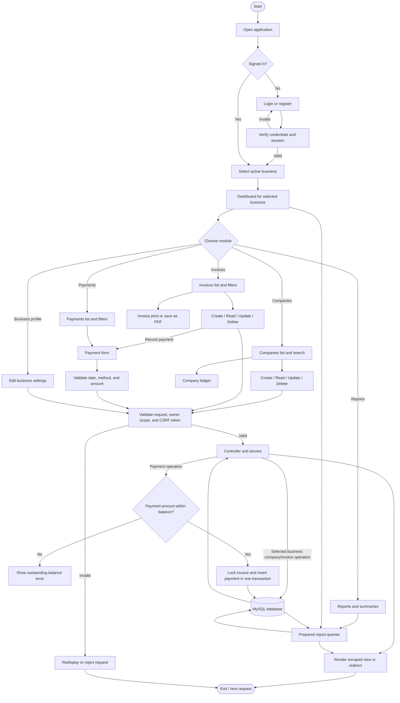

# System Flowchart

The user signs in or registers before opening the workspace. All pages use
query-string routes such as `index.php?r=invoices/index`; Apache rewrite rules
are not required.

Every POST request is checked for a CSRF token. Create, update, delete, and
business-switch actions use POST. Server queries enforce the authenticated
owner's active business. Invoice and payment amounts are calculated or checked
on the server; browser previews are not trusted.

## PNG for Word / PDF

The included PNG is an older login-less snapshot; regenerate it from this Mermaid diagram.

