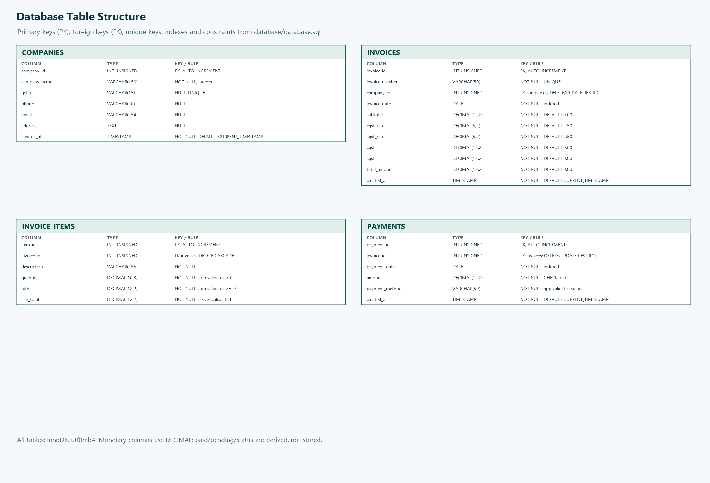

# Table Structure

The importable schema is [`../database/database.sql`](../database/database.sql).
All tables use InnoDB and `utf8mb4_unicode_ci`. `UNSIGNED` applies to integer
identifiers. Unless noted otherwise, columns are `NOT NULL`.

## PNG for Word / PDF

## `companies`

| Column | Type | Null | Key / constraint | Default / notes |
|---|---|---:|---|---|
| `company_id` | `INT UNSIGNED` | No | Primary key | `AUTO_INCREMENT` |
| `company_name` | `VARCHAR(150)` | No | Indexed (`idx_companies_company_name`) | Company name |
| `gstin` | `VARCHAR(15)` | Yes | Unique | Optional; multiple `NULL` values permitted |
| `phone` | `VARCHAR(20)` | Yes | — | Optional |
| `email` | `VARCHAR(254)` | Yes | — | Optional |
| `address` | `TEXT` | Yes | — | Optional |
| `created_at` | `TIMESTAMP` | No | — | `CURRENT_TIMESTAMP` |

## `invoices`

| Column | Type | Null | Key / constraint | Default / notes |
|---|---|---:|---|---|
| `invoice_id` | `INT UNSIGNED` | No | Primary key | `AUTO_INCREMENT` |
| `invoice_number` | `VARCHAR(50)` | No | Unique | Generated by invoice service |
| `company_id` | `INT UNSIGNED` | No | FK `fk_invoices_company`; indexed | References `companies.company_id`; delete/update restricted |
| `invoice_date` | `DATE` | No | Indexed (`idx_invoices_invoice_date`) | Invoice date |
| `subtotal` | `DECIMAL(12,2)` | No | — | `0.00` |
| `cgst_rate` | `DECIMAL(5,2)` | No | — | `2.50` percent |
| `sgst_rate` | `DECIMAL(5,2)` | No | — | `2.50` percent |
| `cgst` | `DECIMAL(12,2)` | No | — | `0.00` |
| `sgst` | `DECIMAL(12,2)` | No | — | `0.00` |
| `total_amount` | `DECIMAL(12,2)` | No | — | `0.00` |
| `created_at` | `TIMESTAMP` | No | — | `CURRENT_TIMESTAMP` |

## `invoice_items`

| Column | Type | Null | Key / constraint | Default / notes |
|---|---|---:|---|---|
| `item_id` | `INT UNSIGNED` | No | Primary key | `AUTO_INCREMENT` |
| `invoice_id` | `INT UNSIGNED` | No | FK `fk_invoice_items_invoice`; indexed | References `invoices.invoice_id`; delete cascades, update restricted |
| `description` | `VARCHAR(255)` | No | — | Item description |
| `quantity` | `DECIMAL(10,3)` | No | — | Positive quantity is enforced by application validation |
| `rate` | `DECIMAL(12,2)` | No | — | Non-negative rate is enforced by application validation |
| `line_total` | `DECIMAL(12,2)` | No | — | Server-calculated line amount |

## `payments`

| Column | Type | Null | Key / constraint | Default / notes |
|---|---|---:|---|---|
| `payment_id` | `INT UNSIGNED` | No | Primary key | `AUTO_INCREMENT` |
| `invoice_id` | `INT UNSIGNED` | No | FK `fk_payments_invoice`; indexed | References `invoices.invoice_id`; delete/update restricted |
| `payment_date` | `DATE` | No | Indexed (`idx_payments_payment_date`) | Payment date |
| `amount` | `DECIMAL(12,2)` | No | `chk_payments_amount_positive`: `amount > 0` | Payment amount |
| `payment_method` | `VARCHAR(50)` | No | — | Application accepts Cash, UPI, Bank Transfer, or Cheque |
| `created_at` | `TIMESTAMP` | No | — | `CURRENT_TIMESTAMP` |

Paid amount, pending balance, and payment status are **not columns**. They are
derived from payment rows. Monetary database columns use `DECIMAL`; application
money calculations use integer paise.
